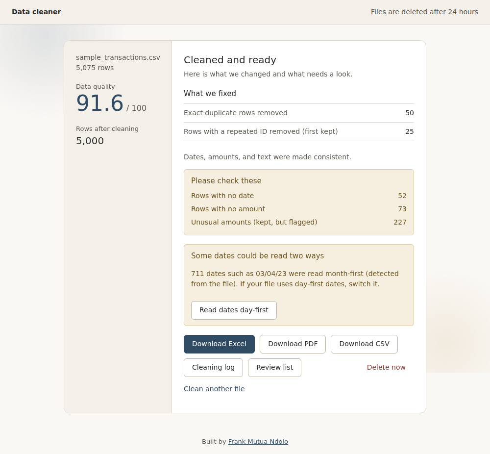
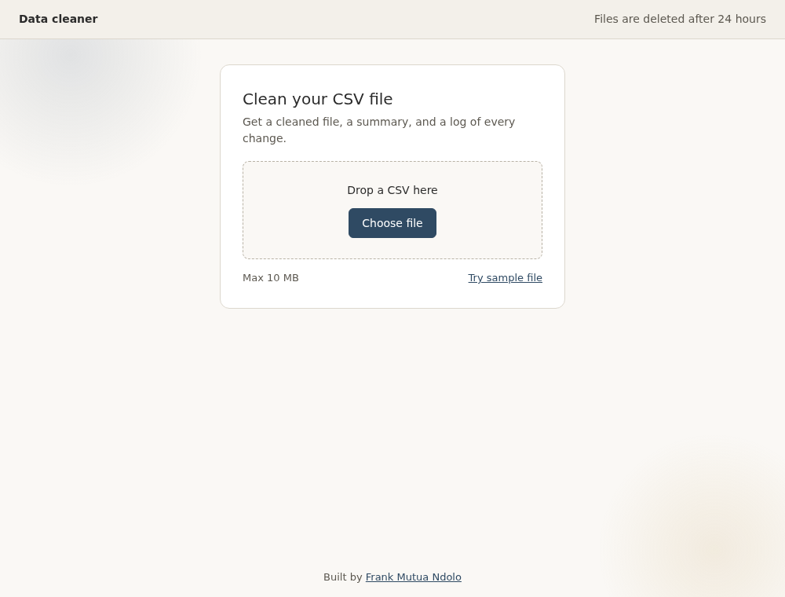
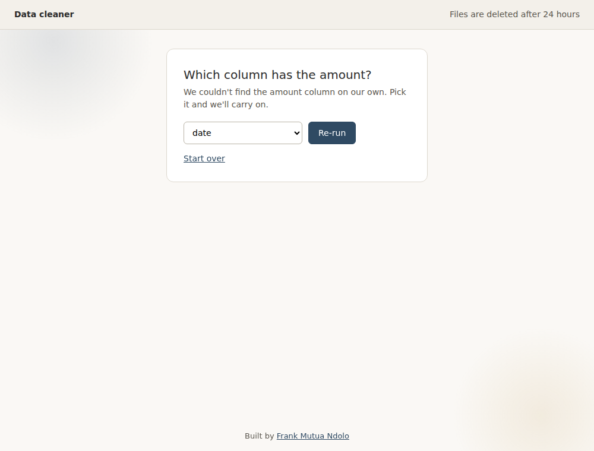
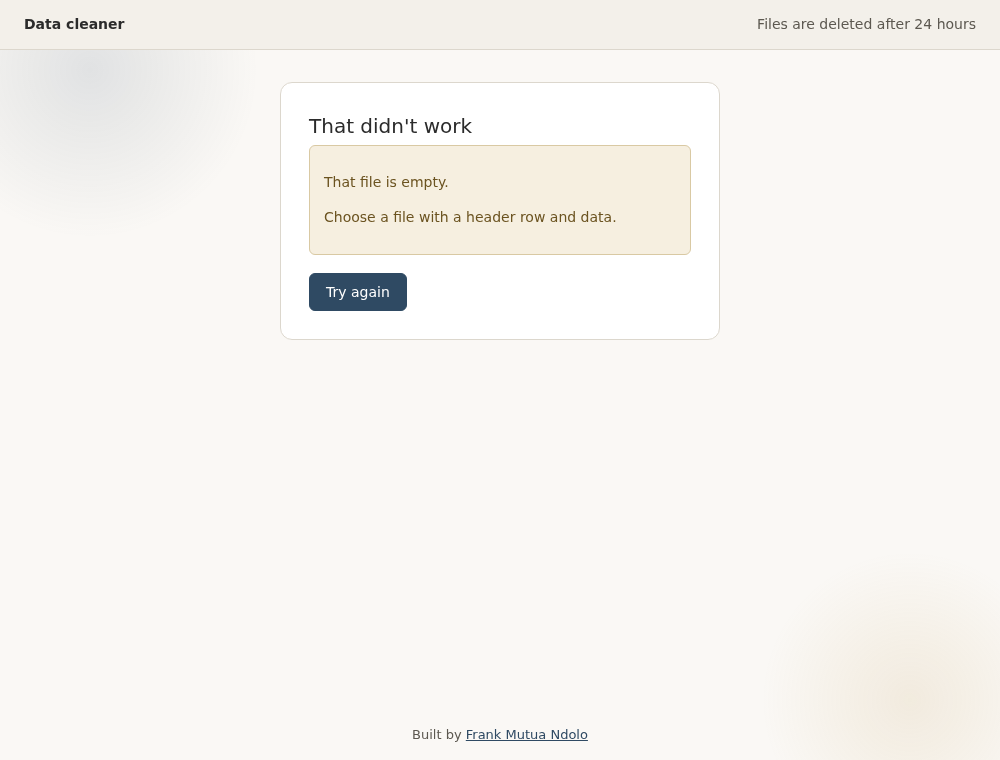
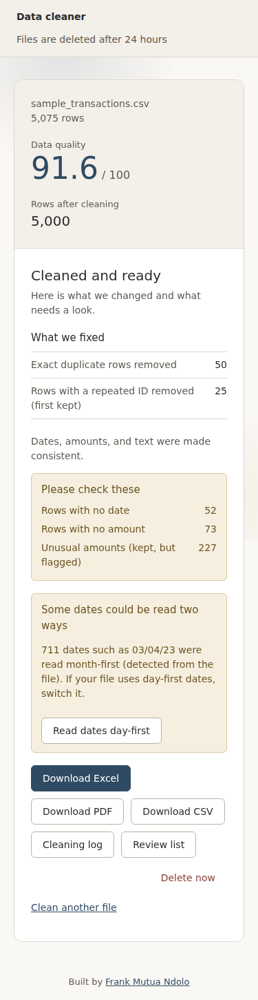
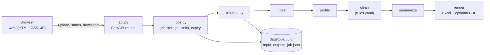

# Report generator

Upload a messy transactions CSV. Get back a cleaned file, an Excel report with totals, a short PDF summary, a list of rows that need a human look, and a log of every change. Problems are flagged and counted, never silently fixed or hidden.

More screens

| Upload | Choose a column | Error | Phone |
|---|---|---|---|
|  |  |  |  |

## How it fits together

Each box is one small file with one job. `api.py` contains no logic, so almost everything is tested without a web server.

## Run it

    pip install -r requirements.txt
    python -m uvicorn app.api:create_app --factory --reload     # then open http://127.0.0.1:8000/

Or use the pipeline directly from the command line:

    python -m app.pipeline samples/messy_finance_transactions.csv --out data/jobs/demo

Outputs in the job folder: `report.xlsx`, `report.pdf`, `clean.csv`, `log.md`, `job.json`, and `review_duplicates.csv` when needed.
If the Excel build ever fails, the job still succeeds with the CSV and log, and `job.json` carries a warning.
Exit codes: 0 done, 2 needs a column mapping, 1 failed.

## Rules
Everything format-specific lives in `app/rules.yaml` (date formats, currency symbols, booleans, outlier method).
Change a rule, bump `rules_version`.

## Quality score
Share of input rows with a valid date, a valid amount, and no outlier flag. Removed duplicates count against it.

## Decisions
- Exact duplicate rows are removed. Rows sharing an ID but differing in content: first kept, all listed in `review_duplicates.csv`.
- Slash dates: the order is detected from the file (03/25/23 can only be month-first, 25/03/23 only day-first). With no evidence, or mixed evidence, the default (month-first) is used and the report says so. `--date-order day|month` overrides. Ambiguous dates are counted and warned about on the Summary sheet.
- Outliers are flagged, never deleted. Unreadable values become blank and are counted.
- Required columns: date, amount. Missing ones return `needs_input` (use `--date-column` / `--amount-column`).
- Not used on purpose: pandera, hypothesis, mypy, a database, a queue, any LLM in the cleaning path.

## Excel report
- Summary: score, issue counts, ambiguous-date warning, totals by category and by month (all rows, and excluding flagged amounts). Totals are live formulas over the Clean data sheet.
- Clean data: every cleaned row, real dates and numbers, filters on.
- Review: one line per row that needs a human look (missing or unreadable values, flagged amounts, same-ID rows) with the reason.
- Text starting with `=`, `+`, `-`, `@` is stored as text so it can never run as a formula. (`clean.csv` is not escaped; open it as data, not as a trusted spreadsheet.)
- `samples/example_report.xlsx` is a real output with values already calculated.

## PDF report (optional)
`app/pdf.py` builds a short summary (score, what was fixed, what to check, totals by category) with reportlab and built-in fonts.
It never blocks anything: if reportlab is missing or the PDF fails, the job still succeeds with the Excel, CSV and log, and `job.json` carries a warning.
Download kind: `pdf`.

## Known limit (Tier 2)
Misspelled categories (Entertainmnt, Shoping) still appear as separate rows in the category totals.

## API

Interactive docs at http://127.0.0.1:8000/docs while the server runs.

| Endpoint | Purpose |
|---|---|
| `POST /api/jobs` | Upload a CSV (form field `file`, optional `date_order`); returns the job |
| `GET /api/jobs/{id}` | Status, results, and download links |
| `POST /api/jobs/{id}/rerun` | Re-run with `{date_column, amount_column, date_order}` |
| `GET /api/jobs/{id}/files/{xlsx|pdf|csv|log|review}` | Download (`pdf` is absent if the optional PDF could not be built) |
| `DELETE /api/jobs/{id}` | Delete now |
| `GET /api/health` | Liveness |

Errors always look like `{"error": {"code", "message", "fix"}}`: `file_too_large` 413, `empty_file` / `not_a_csv` / `invalid_request` 422,
`job_not_found` 404, `job_expired` 410. A missing column is not an error: the job comes back as `needs_input` with the options.

Design notes
- All logic is in `app/jobs.py` (no web framework); `app/api.py` only maps HTTP to it. Most tests run without FastAPI installed.
- Jobs are folders under `REPORT_DATA_DIR` (default `data/jobs`), named by random UUID4. Client filenames are used for display only, never for paths.
- Uploads stream to disk and are cut off at 10 MB. Downloads come from a fixed whitelist of four files.
- Jobs expire after 24 hours: files are deleted, a small marker stays for 7 days so clients get "expired", not "not found". Cleanup runs at startup and on every upload.
- Processing is synchronous in v1. The `status` field is already in the response, so going async later changes nothing for clients.
- No CORS (the front end is served by the same app), no accounts, no listing endpoint. An access token is added at public deploy.

## Web page
Served by the same app (no CORS, no build step) at http://127.0.0.1:8000/.

- `web/index.html`, `web/style.css`, `web/app.js`: about 220 lines of plain JavaScript, no framework.
- Six states: upload, working, done, needs a column choice, failed, expired. Each is a real screen with a plain-language message and a next step.
- The job id lives in the URL (`#job=...`), so refresh and bookmarks work. Nothing is stored in the browser.
- Keyboard: the drop zone is a real file input behind a label. Screen readers get status updates through a live region.
- Safety: all dynamic text is inserted as text, never as HTML (a filename like `` is shown literally).
- Motion: one slow background drift on the upload screen only; it pauses on other screens and is off for "reduce motion".
- "Try sample file" loads `samples/messy_finance_transactions.csv` through `/sample.csv`.

## Design tokens
Page `#faf8f5`, panel `#f3f0ea`, line `#dcd7cd`, ink `#2b2b2b`, muted `#5c5850`, accent `#2f4a63`, review box `#f6efe0` / `#6b5320`.
One system font stack, 6px corners, no shadows.

## Tests and quality checks
    pip install -r requirements-dev.txt
    ruff check .
    python -m unittest discover -s tests -t .          # 47 tests; the HTTP ones skip themselves if FastAPI is missing

GitHub Actions (`.github/workflows/ci.yml`) runs the same two commands on Python 3.11 and 3.13 for every push.

## Scope
This is a portfolio project that runs on your own machine, not a hosted service. It has no accounts or database on purpose, and uploads are
deleted after 24 hours. Nothing in it is meant to be exposed to the public internet as is. Licensed under MIT.
